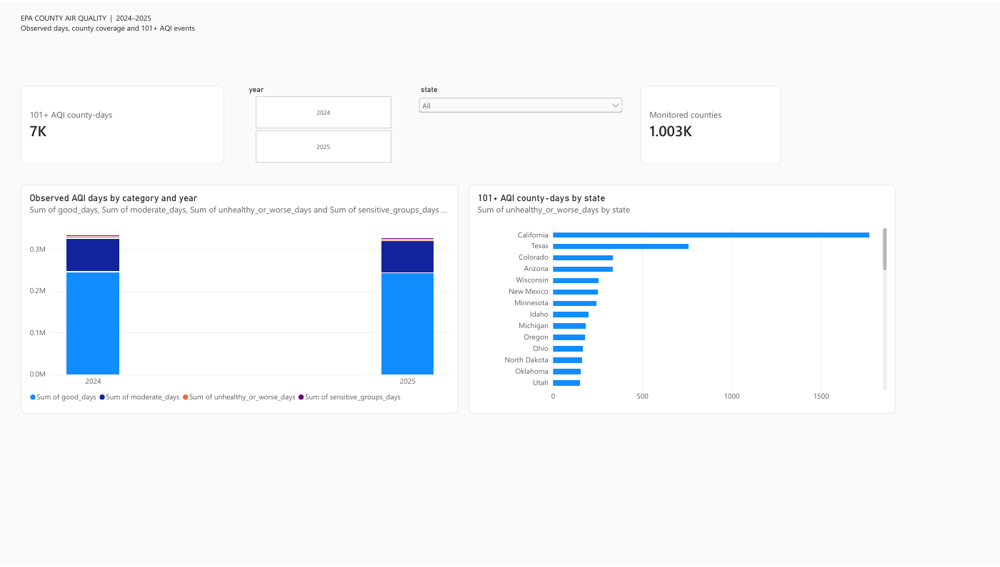

# County air quality | EPA AirData and Power BI

**Status:** validated 2024–2025 county-year dataset and two-page Power BI report.

[Power BI report (sign-in/access may be required)](https://app.powerbi.com/groups/e6426da3-9b36-4519-acf1-2434daa552ae/reports/c9da0c3a-5f6d-428f-8d30-ee96e9470cf4/4f22284d93d2306760c3?experience=power-bi) · [Two-page PDF](epa-county-aqi-report.pdf) · [Findings](FINDINGS.md)

The **AQI overview** offers a 101+ AQI county-day KPI, distinct monitored-county KPI, year tile and state dropdown, a year/category composition chart, and a state comparison. Selecting a year or state updates the displayed measures. **County detail** is a sortable county-year table with observed days, 101+ AQI days, observed-day share and monitoring coverage. [View the second page](county-detail.png).

The PDF is a static export of the report's default, all-years view. Its rounded KPI card shows 7K; the validated exact total is **7,115** county-days at AQI 101+ across both years. County-days are summed over counties and may occur on the same calendar day; they are not unique U.S. days.

## Question

How do recorded AQI category days vary among monitored U.S. counties and territories, and what changes when comparisons require substantial observation coverage in both years?

## Source and reproduction

The input is the U.S. EPA's [AirData annual AQI by county files](https://aqs.epa.gov/aqsweb/airdata/download_files.html): [2024 ZIP](https://aqs.epa.gov/aqsweb/airdata/annual_aqi_by_county_2024.zip) and [2025 ZIP](https://aqs.epa.gov/aqsweb/airdata/annual_aqi_by_county_2025.zip). Run `python build_dataset.py` with Python 3.10+ to download the files and regenerate `epa_county_aqi_2024_2025.csv` and `validation_summary.json`. No API key or third-party Python package is needed. The validation summary records raw-file SHA-256 hashes so a future refresh can be distinguished from this snapshot.

EPA defines [Days with AQI and the category-day counts](https://www.epa.gov/outdoor-air-quality-data/about-airdata-reports) as days for which a reported county AQI exists and days falling in each AQI range. EPA cautions that monitoring coverage and pollutants measured vary by place. These are monitored-area summaries, not population exposure estimates.

## Grain and measures

One row is one **state/territory, county, year**. `unhealthy_or_worse_days` adds days in **Unhealthy for Sensitive Groups (AQI 101–150)**, **Unhealthy (151–200)**, **Very Unhealthy (201–300)**, and **Hazardous (301+)**. `unhealthy_share_observed_pct` divides that count by **Days with AQI**, rather than calendar days. `coverage_pct` separately divides Days with AQI by 365 or 366 calendar days. A county with sparse AQI observations must not be read as having many clean days.

The source ZIPs have **997 rows for 2024** and **985 for 2025**. Each includes one `Country Of Mexico / SONORA` row, excluded from the curated U.S./territories panel. The curated CSV therefore has **1,980 county-year rows** (996 and 984). There are **977 matched counties** and **773** with at least **300 reported AQI days in both years**. The binary `matched_300plus_both_years` marks this comparison panel. The 2025 row alone carries `county_change_share_pp_2025_minus_2024`; it is a percentage-point change and is blank outside that panel.

The script verifies that the six AQI-category counts and the main-pollutant day counts each reconcile to Days with AQI for every source row, that county-year keys are unique, and that observed-day counts fit the calendar. See [findings and limits](FINDINGS.md).

## Files

| File | Purpose |
| --- | --- |
| `build_dataset.py` | Official-file download, cleanup, and validation |
| `epa_county_aqi_2024_2025.csv` | Curated Power BI source |
| `validation_summary.json` | Source hashes, coverage, and reconciliation |
| `FINDINGS.md` | Descriptive results and interpretation limits |
| `epa-county-aqi-report.pdf` | Two-page static Power BI export |
| `overview.png`, `county-detail.png` | Dashboard and table previews |

